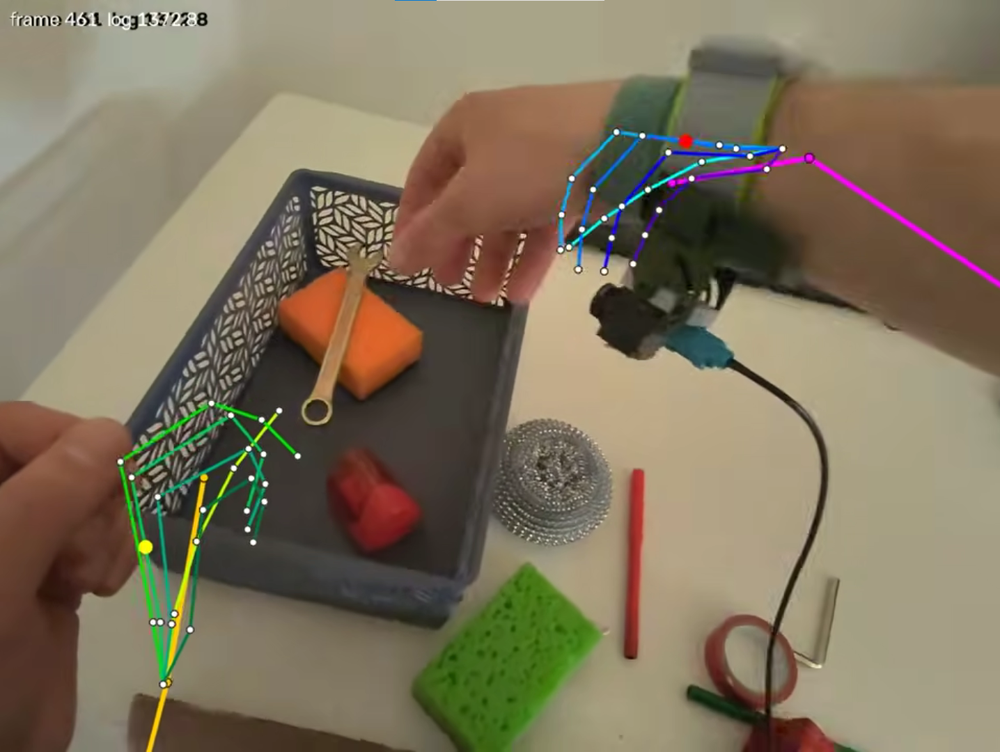
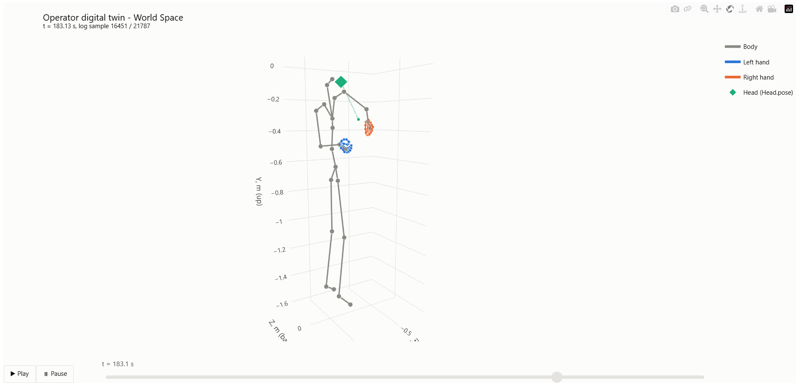
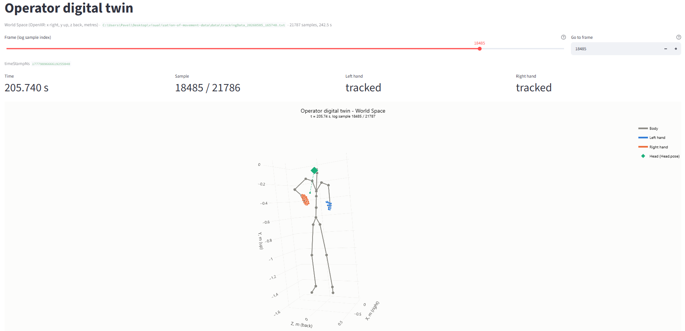

# XR Telemetry Visualization: Operator Digital Twin

Visualization toolkit for VR telemetry logs (OpenXR / Unity) recorded together with a
first-person stereo camera. The tracking log contains camera calibration and per-sample
3D poses of the operator's **head**, **body** (24 joints) and **both hands** (26 joints each).
The project turns that raw data into three complementary views:

| Mode | Command | Output | What it is for |
|------|---------|--------|----------------|
| **AR video overlay** | `python main.py video` | `data/output_tracking.mp4` | The 3D skeleton projected onto the left eye of the side-by-side stereo video. Validates calibration and the projection math against the real image. |
| **Offline 3D player** | `python main.py html` | `data/skeleton_3d_animated.html` | Self-contained animated Plotly scene of the digital twin in World Space, with Play/Pause and a timeline slider. Opens in any browser without Python or internet. |
| **Interactive dashboard** | `python main.py dashboard` | http://localhost:8501 | Streamlit web app for inspecting **any** of the ~21k samples frame by frame, with an exact frame input. |

---

## Demo

<!-- Insert the YouTube link here, e.g. [](https://www.youtube.com/watch?v=VIDEO_ID) -->
**Video:** [_https://youtu.be/r9sNabTIp1o?si=sl7b-HI1ocS1WyGf_](https://youtu.be/r9sNabTIp1o?si=sl7b-HI1ocS1WyGf)

<!-- Insert the screenshot paths here (e.g. put the images in docs/) -->
**AR overlay on the stereo video:**


**Offline 3D player:**


**Streamlit dashboard:**


---

## Installation & Usage

### 1. Input data

Put the raw recording into the `data/` folder (it is git-ignored, only `data/.gitkeep` is tracked):

```
data/
├── CameraRecord_<YYYYMMDD_HHMMSS>.mp4    # side-by-side stereo video
└── trackingData_<YYYYMMDD_HHMMSS>.txt    # telemetry log (JSON lines)
```

Files are detected automatically by these name patterns. If several recordings are present, the
most recent one (by the timestamp in the file name) is used. Explicit paths can always be
passed with `--video` / `--tracking`.

### 2. Environment

Python 3.10+ is required (developed and tested on Python 3.14).

```bash
python -m venv venv

# Windows
venv\Scripts\activate
# Linux / macOS
source venv/bin/activate

pip install -r requirements.txt     # numpy, opencv-python, plotly, streamlit
```

### 3. Running: single entry point `main.py`

```bash
python main.py --help               # list of commands
python main.py <command> --help     # options of a specific command
```

**AR video overlay** (renders every frame of the video):

```bash
python main.py video                         # full video -> data/output_tracking.mp4
python main.py video --max-frames 300        # quick check: first ~10 s only
python main.py video --hands rightHand --no-body
```

**Offline 3D player**:

```bash
python main.py html                          # 250 frames over the whole log
python main.py html --frames 100 --frame-ms 150
```

Open `data/skeleton_3d_animated.html` by double-clicking it.

**Interactive dashboard**:

```bash
python main.py dashboard                     # then open http://localhost:8501
python main.py dashboard --server.port 8502  # extra options go to `streamlit run`
python main.py dashboard -- --tracking path/to/trackingData_X.txt
```

The log is parsed once per server start (about 10 s, cached with `@st.cache_data`). After that,
each slider move renders the selected sample in a fraction of a second. The server starts in
headless mode (see `.streamlit/config.toml`), so it does not prompt for anything and does not
open a browser tab on its own. Stop it with `Ctrl+C`.

### Project structure

```
├── main.py                  # CLI entry point: video | html | dashboard
├── src/
│   ├── parser.py            # log parsing, Unity comma-bug recovery, numpy arrays
│   ├── visualize.py         # transforms, projection, time sync, OpenCV rendering
│   ├── visualize_3d.py      # animated Plotly player (+ shared 3D styling)
│   └── dashboard.py         # Streamlit app
├── .streamlit/config.toml   # headless server settings
├── data/                    # raw inputs and generated outputs (git-ignored)
└── requirements.txt
```

`src/parser.py` can also be run on its own as a sanity check:
`python src/parser.py --full` prints the decoded calibration, the first sample and statistics for the whole log.

---

## Data Parsing & Normalization

### Log format

* **Line 1, header.** `cameraIntrinsics` is a string of 4 numbers. `cameraExtrinsics` holds two
  row-major 4×4 matrices separated by `|` (left eye first, then right eye). `timeStampNs` is the
  time of the first video frame.
* **Lines 2…N, one telemetry sample per line** (~90 Hz; 21,787 samples over 242.5 s in the
  reference recording). Each sample has `timeStampNs`, `Head.pose`, `Body.joints` (24) and
  `Hand.leftHand` / `Hand.rightHand` (26 OpenXR hand joints + `isActive`). Every position is
  given in one global tracking frame, World Space (OpenXR: `x` right, `y` up, `z` backwards, metres).

### The Unity localization bug ("comma bug")

The pose strings were serialized with Unity's `float.ToString()` under a locale whose decimal
separator is a comma, and the values were then joined with commas as well. The comma therefore
serves **both** as the decimal point and as the list separator. A raw `Head.pose`
(`x, y, z, qx, qy, qz, qw`) looks like this:

```
"-0,08517717,-0,02745685,-0,0058761,0,162562191,-0,2861428,-0,116477557,-0,9370853"
```

Read naively, this gives 14 meaningless numbers. The key observation is that **every float
produces exactly two comma-separated tokens**: its signed integer part and its fractional part.
The original values can therefore be restored without guessing:

1. split the string by `,` into 14 tokens;
2. group the tokens into consecutive pairs;
3. join each pair with `.` and convert to `float`.

```
["-0","08517717", "-0","02745685", "-0","0058761", "0","162562191", ...]
  -> [-0.08517717, -0.02745685, -0.0058761, 0.162562191, -0.2861428, -0.116477557, -0.9370853]
```

Implementation details (`parse_comma_bug_floats` in `src/parser.py`):

* **Scientific notation survives.** The exponent stays attached to the fractional token, so
  `"-5,809443E-05"` becomes `-5.809443E-05`.
* **Strict validation.** A pose must yield exactly `2 × 7 = 14` tokens. A value printed without a
  fractional part (e.g. an exact `0`) would make the pairing ambiguous, so such a line is rejected
  with a warning instead of being silently mis-decoded. No line of the reference log is rejected.
* **Same fix everywhere.** The fix is applied to `Head.pose` (all 7 values kept) and to the `p`
  array of every body and hand joint, where only the position `x, y, z` (first 3 floats) is used.
* **Missing data is explicit.** An absent hand or body becomes `NaN` (and the hand is marked
  inactive), so one missing part never drops the whole sample.

The whole log is stored as stacked numpy arrays: `head_poses (N, 7)`, `hands_joints (N, 2, 26, 3)`,
`hands_active (N, 2)`, `body_joints (N, 24, 3)`.

---

## Mathematical Pipeline (World Space → video pixels)

All transforms are 4×4 homogeneous matrices acting on column vectors. The camera is rigidly
mounted on the headset, so the only time-varying part is the head pose:

```
Head_to_World   = [ R(q_head) | t_head ]                    from Head.pose (x, y, z, qx, qy, qz, qw)
Camera_to_Head  = EXTRINSICS_TO_HEAD @ cameraExtrinsics[0]  left-eye camera, constant
World_to_Camera = inv(Head_to_World @ Camera_to_Head)

[X, Y, Z, 1]ᵀ = World_to_Camera @ [x_w, y_w, z_w, 1]ᵀ
u = fx · X / Z + cx
v = fy · Y / Z + cy                                         (pinhole model)
```

**Extrinsics.** We use the first matrix of `cameraExtrinsics`, the left eye. Its rotation is written
in the headset's device axes (`x` up, `y` left, `z` back), while `Head.pose` uses OpenXR head axes
(`x` right, `y` up, `z` back). `EXTRINSICS_TO_HEAD` is the fixed change of basis between the two
conventions: a pure axis permutation with no offsets and no fitted parameters. With it applied, the
camera looks along the head's forward direction with image `x` to the right and image `y` down,
which is the standard OpenCV camera convention.

**Intrinsics.** The data shows that the header stores `[cx, cy, fx, fy]`, not `[fx, fy, cx, cy]`:
`[1079.5, 404.5, 1373.67, 686.87]`. `(1079.5, 404.5)` is the exact centre of a native 2160×810
image. The video is 2160×810 side-by-side, so each eye is squeezed horizontally into 1080×810.
The parameters are therefore rescaled to the eye image (`sx = 0.5`, `sy = 1`), which gives
`fx ≈ 686.8 px ≈ fy`. The pixels come out square, which confirms this reading. Lens distortion
is not part of the calibration and is not modeled.

**Stereo video.** Every frame is cropped to its left half (`width // 2`) before drawing, matching
the left-eye extrinsics.

**Time synchronization.** Frames are matched to telemetry by **timestamps**, not by a linear index
mapping. Frame `i` corresponds to `t = header.timeStampNs + i / fps`. Telemetry (~90 Hz) is
interpolated to that exact time, since the video runs at 30 fps:
- positions use linear interpolation;
- the head orientation uses quaternion nlerp (with a hemisphere check);
- a hand counts as active only if both neighbouring samples are active, so it is never
  interpolated across a tracking gap.

Points behind or too close to the camera (`Z ≤ 2 cm`) are not drawn.

The 3D player and the dashboard skip projection entirely: they plot the same parsed data directly
in World Space with `aspectmode='data'`, so the body proportions are not distorted by axis scaling.

---

## Observations & Architectural Decisions

### Projection accuracy: left hand and body

On the video overlay, the **left hand** and the **body skeleton** (torso, shoulders, arms) fall
precisely onto the operator's real limbs. This is the key validation of the pipeline. Each of those points travels through the full chain:
- parsing with the comma-bug fix;
- the head pose at the interpolated timestamp;
- the camera extrinsics;
- the intrinsics.

An error in any of these stages would show up as misalignment, rotation, scale error or lag. None
is visible, so the transforms, the calibration interpretation and the time synchronization are
correct.

### Systematic offset of the right hand

The **right hand**, in contrast, shows a **systematic spatial offset** on the video: its skeleton
is consistently displaced from the real right hand, while the left hand in the same frames is
aligned.

This cannot be a defect of the projection math. Every point in a frame, left hand, right hand and
body alike, goes through **the same** `World_to_Camera` matrix and **the same** `K`. A wrong
transform, wrong intrinsics or a time offset would distort all of them in a consistent way. It
cannot displace a single limb while leaving the others in place. The error must therefore already
be present in the **input World Space coordinates of the right hand**. The most likely causes are:

* **Hardware calibration error of the right-wrist tracker.** An imperfect offset between the
  tracking device and the actual wrist or hand shifts every right-hand joint by a roughly constant
  vector.
* **IK / pose-estimation error.** The tracking runtime reconstructs the hand and arm with an
  inverse-kinematics or hand-model algorithm. A bias in that solution for one side produces a
  displacement on that side only.

### Decision: no manual correction

We **deliberately do not** apply hard-coded pixel offsets (such as `u - 50`) or ad-hoc
translations to make the right hand "look right":

* **Mathematical integrity.** The pipeline stays a pure, physically meaningful transform chain
  from telemetry to pixels, with no parameters tuned by eye. The time offset `TIME_OFFSET_SEC` is
  also kept at `0`.
* **No masking of data problems.** A fitted offset would hide a real calibration issue in the
  source data instead of reporting it. It would also be valid only for this one recording, this
  camera position and this distance to the hand.
* **Traceability.** Every pixel on the overlay can be explained from the raw log and the header
  calibration. The fix belongs where the error comes from: recalibrating the right-hand tracker or
  correcting the IK. It does not belong in the visualization layer.

The 3D player and the dashboard show the same raw World Space data. They can be used to inspect
the right hand's position relative to the body skeleton independently of the camera model.
